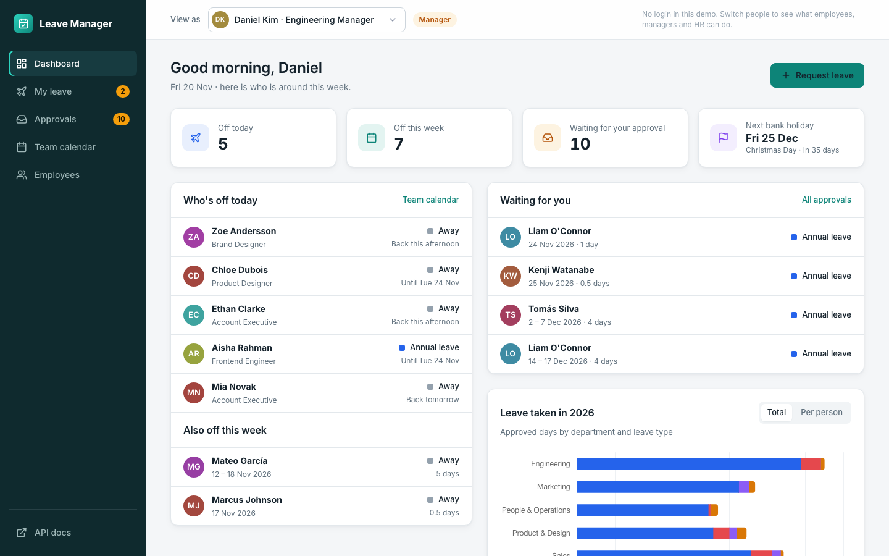
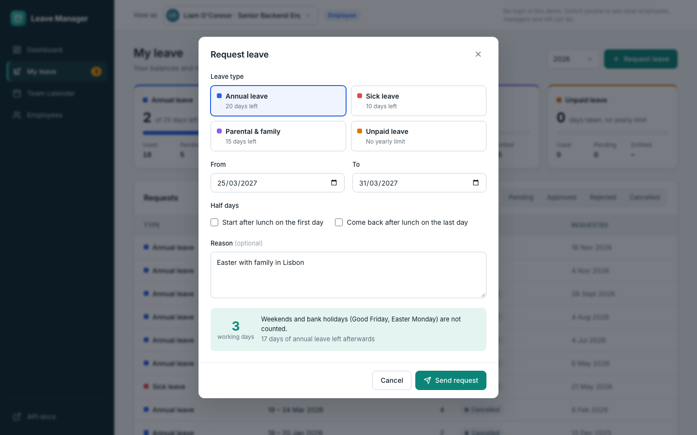
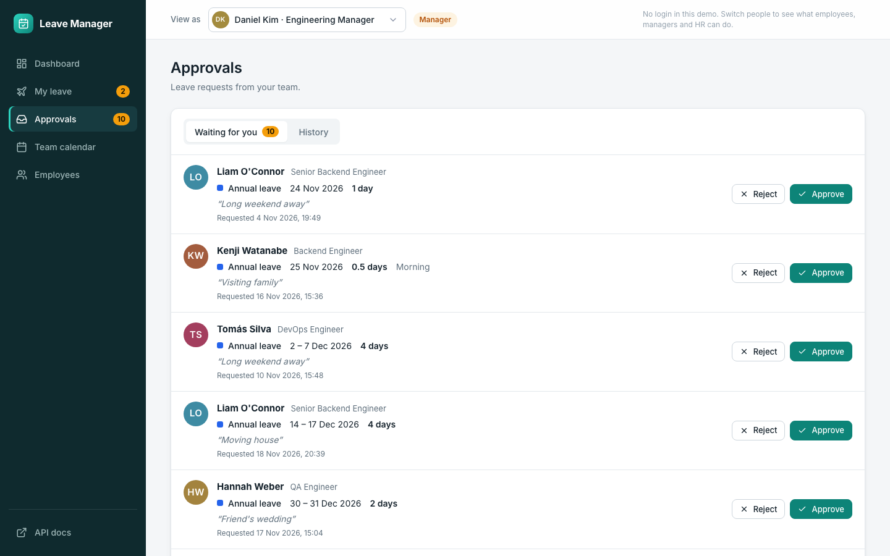
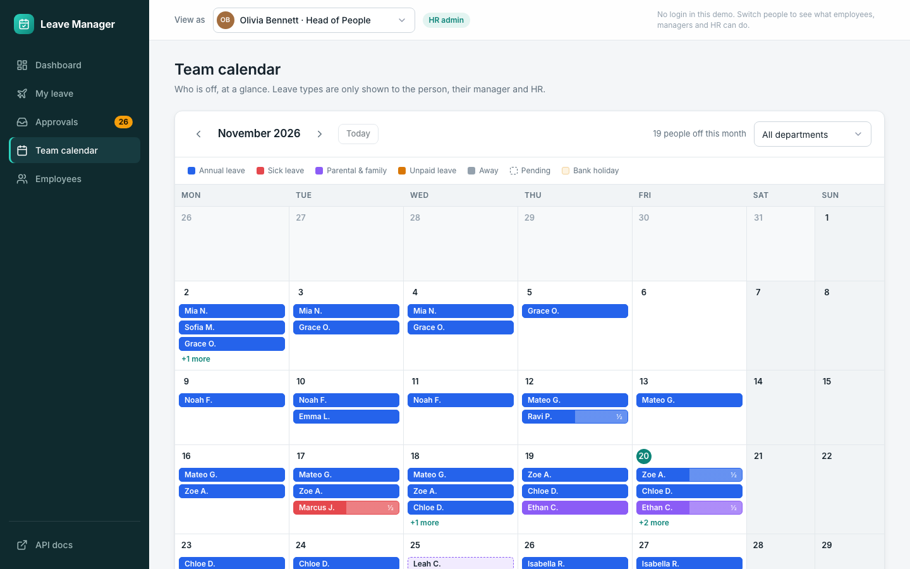
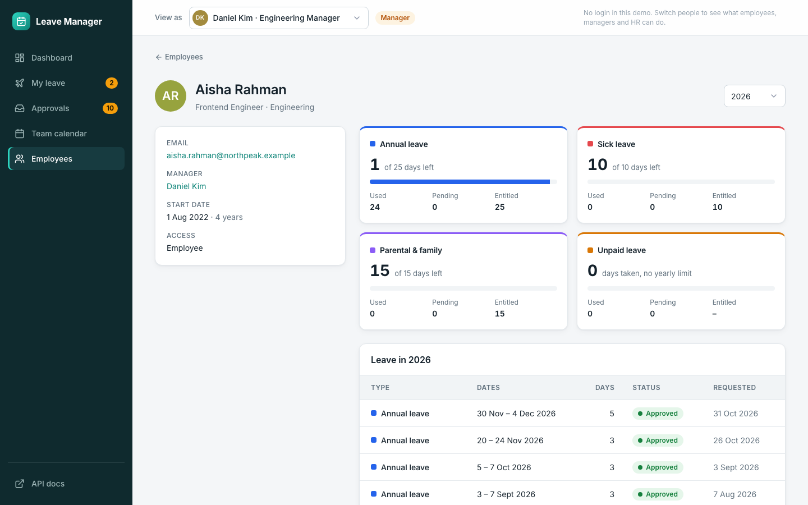

# HR Leave Management

Book time off, approve requests and see who is away, with leave balances worked out from real working days.

**Live demo:** https://hkhodkar.github.io/hr-leave-management/



The demo runs entirely in the browser with sample data for a 25-person company. There is no login: use the **View as** picker in the header to switch between an employee, a manager and an HR admin and see how the app (and the API's permissions) change.

## Features

- **Role switcher** – view the app as any seeded employee, manager or HR admin. The API reads the acting user from an `X-User-Id` header and enforces who may see and do what.
- **Leave requests** – annual, sick, parental & family and unpaid leave, with half days (start after lunch, back after lunch, morning or afternoon only).
- **Live working-day count** – the request form counts working days as you pick dates, skipping weekends and bank holidays, and shows what is left of the balance.
- **Validation on both sides** – end date not before start, no overlap with your pending or approved leave (half days can share a day), enough balance left, past dates only for sick leave.
- **Balances** – entitled, used, pending and remaining per leave type and year, with the allowance prorated for people who join mid-year.
- **Approval flow** – managers approve or reject their team's requests (a comment is required to reject), HR can decide for anyone but themselves. Employees can cancel pending requests and approved leave that has not started yet.
- **Audit trail** – every request keeps a history of who submitted, approved, rejected or cancelled it and when.
- **Badges** – pending counts for your own requests and for requests waiting for your approval.
- **Team calendar** – month view coloured by leave type, half days and pending requests marked, department filter. On phones it turns into an agenda list. Coworkers only see "Away", the leave type stays private to the person, their manager and HR.
- **Dashboard** – who is off today and this week, requests waiting for you, the next bank holiday and a Chart.js chart of leave taken per department.
- **Employees** – searchable, filterable and paginated directory, employee profile with balances and leave history, add and edit employees in a modal (HR only).
- **Demo mode** – the GitHub Pages build answers every API call from an in-browser mock with the same shapes, validation and permissions as the FastAPI backend, saves changes to localStorage and has a Reset data button.

## Screenshots

| Request form | Approvals |
| --- | --- |
|  |  |

| Team calendar | Employee profile |
| --- | --- |
|  |  |

## Tech stack

**Frontend:** Angular 21 (standalone components, signals, `resource`, typed reactive forms, new control flow, zoneless, OnPush), custom SCSS, Chart.js through a small directive, Vitest.

**Backend:** FastAPI, SQLModel on SQLite, Pydantic v2, pytest, Ruff.

**Tooling:** Docker Compose, GitHub Actions (tests on every push, demo deployed to GitHub Pages).

## Getting started

### With Docker

```bash
docker compose up --build
```

- App: http://localhost:8080
- API docs (Swagger UI): http://localhost:8000/docs

The database is seeded with demo data on first start.

### Local development

Backend (Python 3.12):

```bash
cd backend
python -m venv .venv && source .venv/bin/activate
pip install -r requirements-dev.txt
uvicorn app.main:app --reload --port 8106
```

Frontend (Node 22):

```bash
cd frontend
npm install
npm start   # http://localhost:4306, /api is proxied to port 8106
```

If the API is not running, the frontend switches to demo mode by itself and uses the in-browser data.

### Tests

```bash
cd backend && pytest          # balances, validation, permissions, approval flow, seed data
cd frontend && npm test       # working days, form validators, calendar grid, mock API
```

### API

Interactive docs are at `/docs`. Every call except `GET /api/session/users` needs an `X-User-Id` header:

```bash
curl -H "X-User-Id: 2" http://localhost:8000/api/leave-requests?scope=approvals&status=pending
```

| Endpoint | What it does |
| --- | --- |
| `GET /api/session/users`, `GET /api/me` | People for the switcher, profile and badge counts |
| `GET/POST /api/employees`, `GET/PUT /api/employees/{id}` | Directory with search, department filter, sorting and paging |
| `GET /api/employees/{id}/balances?year=` | Entitled, used, pending and remaining days per leave type |
| `GET/POST /api/leave-requests` | List (scoped by role) and create requests |
| `POST /api/leave-requests/{id}/approve`, `/reject`, `/cancel` | Approval flow, with the audit trail in the response |
| `GET /api/calendar?year=&month=` | Absences and bank holidays for a month |
| `GET /api/dashboard` | Who is off, pending counts, usage by department |
| `GET /api/leave-types`, `/api/departments`, `/api/holidays` | Reference data |

## Project structure

```
backend/
  app/
    main.py            app factory, startup seeding
    models.py          SQLModel tables
    schemas.py         request and response models
    services.py        permissions, balances, request validation
    workdays.py        bank holidays, working-day and half-day math
    seed.py            demo company with a year of leave
    routers/           employees, leave requests, calendar and dashboard, reference data
  tests/
frontend/
  src/app/
    core/              API services, models, acting user, date utils, mock API for demo mode
    features/          dashboard, leave (form, detail, my leave), approvals, calendar, employees
    shared/            modal, toasts, pagination, badges, chart directive
docker-compose.yml
```

## Author

Hatef Khodkar – [github.com/hkhodkar](https://github.com/hkhodkar)

## License

MIT
